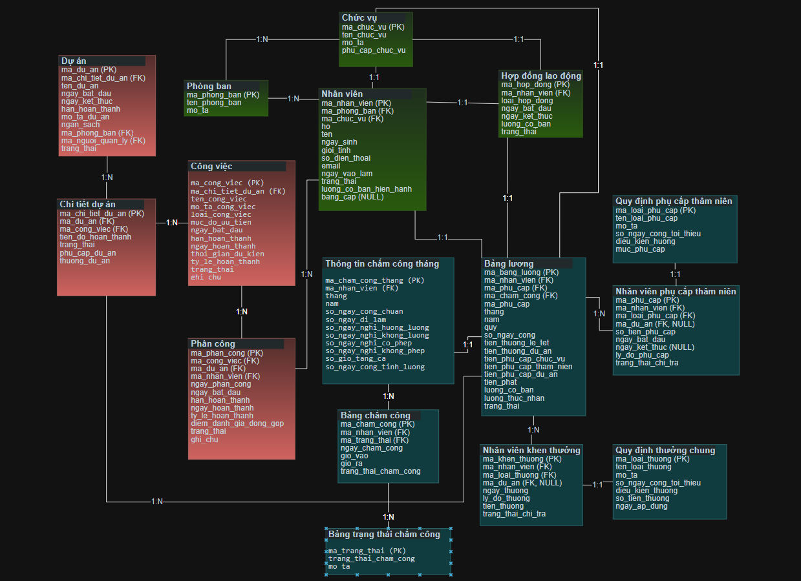

# Ứng dụng quản lý nhân sự

Bộ khung C# WinForms + SQL Server, OOP và kiến trúc 3 lớp **GUI → BUS → DAO**. DTO là thư viện truyền dữ liệu dùng chung. Hiện có luồng tải danh sách nhân viên mẫu; các thư mục mở rộng mới chỉ là khung, chưa triển khai CRUD, tìm kiếm, chấm công, tính lương, thống kê hay nhập/xuất file.

## Cấu trúc

```text
HumanResourceManagement.sln
Directory.Build.props
src/
  GUI/
    Forms/
      MainForm.cs                  # Kèm MainForm.Designer.cs
      HumanResources/              # Xanh lá: nhân sự
      ProjectManagement/           # Đỏ: dự án và công việc
      TimekeepingPayroll/          # Xanh lam: chấm công, lương thưởng
      Lookups/
      Statistics/
      Settings/
    Selection/
    Reports/
    Controls/
    Resources/
  BUS/
    HumanResources/
    ProjectManagement/
    TimekeepingPayroll/
    ServiceFactory.cs
    Statistics/
    Settings/
    ImportExport/
    Reporting/
  DAO/
    HumanResources/
    ProjectManagement/
    TimekeepingPayroll/
    Infrastructure/MyConnection.cs
    Statistics/
    Settings/
  DTO/
    HumanResources/
    ProjectManagement/
    TimekeepingPayroll/
    Statistics/
    Settings/
database/
  01_CreateDatabase.sql
  02_SeedData.sql
docs/
  diagrams/                        # Ảnh ERD và file draw.io gốc
  architecture.md
  project-requirements.md
  report/
  screenshots/
```

Ba nhóm màu có cùng cách chia module trong `GUI/Forms`, `BUS`, `DAO` và `DTO`:

| Màu trên ERD | Thư mục nhóm | Các module con |
|---|---|---|
| Xanh lá | `HumanResources` | `Departments`, `Positions`, `Employees`, `Contracts` |
| Đỏ | `ProjectManagement` | `Projects`, `ProjectDetails`, `Tasks`, `Assignments` |
| Xanh lam | `TimekeepingPayroll` | `MonthlyAttendance`, `Attendance`, `AttendanceStatuses`, `Payroll`, `SeniorityAllowanceRules`, `EmployeeSeniorityAllowances`, `EmployeeRewards`, `RewardRules` |

Các phần hỗ trợ như `Lookups`, `Statistics`, `Settings`, nhập/xuất file và kết nối database được dùng chung. Thư mục chưa triển khai có `.gitkeep` để giữ trong Git. Việc chia nhóm chưa thay đổi schema SQL hoặc triển khai chức năng mới.

## Sơ đồ cơ sở dữ liệu (ERD)

[](docs/diagrams/ERD_quan_ly_nhan_su.png)

Nhấn vào hình để xem ảnh lớn.

[ERD quản lý nhân sự — file draw.io](docs/diagrams/ERD_quan_ly_nhan_su_chu_lon.drawio)

Tải file và mở bằng draw.io/diagrams.net để xem hoặc chỉnh sửa. Sơ đồ chia thành ba nhóm màu tương ứng với cấu trúc module ở trên. Các script SQL hiện vẫn là schema khởi đầu, chưa đồng bộ đầy đủ với ERD này.

## Chạy ứng dụng

1. Cài .NET 10 SDK, SQL Server và IDE hỗ trợ .NET 10/WinForms.
2. Dùng SQL Server Management Studio chạy lần lượt hai script trong database. Script tạo bảng và dữ liệu mẫu chỉ chạy một lần trên database mới.
3. Mở PowerShell tại thư mục solution:

```powershell
$env:HRM_CONNECTION_STRING = 'Server=localhost;Database=HumanResourceManagement;Integrated Security=True;Encrypt=True;TrustServerCertificate=True'
dotnet restore HumanResourceManagement.sln
dotnet build HumanResourceManagement.sln --no-restore
dotnet run --project src/GUI
```

Thay localhost bằng tên SQL Server thực tế, ví dụ .\SQLEXPRESS. TrustServerCertificate=True chỉ dành cho phát triển cục bộ; khi triển khai dùng chứng chỉ hợp lệ. Không lưu mật khẩu vào Git.

Hoặc mở solution trong Visual Studio, đặt GUI làm Startup Project. Cần thiết lập biến môi trường trước khi mở IDE. Bấm **Tải danh sách nhân viên** để kiểm tra kết nối.

## Quy ước

- GUI gọi BUS, không viết SQL trong Form.
- BUS kiểm tra dữ liệu và áp dụng quy tắc nghiệp vụ.
- DAO truy cập SQL Server; dùng tham số SQL khi thêm dữ liệu đầu vào.
- DTO chỉ chứa dữ liệu, không phụ thuộc UI hay database.
- Thêm chức năng theo thứ tự DTO → DAO → BUS → GUI.
- Theo yêu cầu môn học, tìm kiếm trên `ArrayList` sẽ nằm trong BUS; biến `static` phục vụ chọn dữ liệu giữa các Form sẽ nằm trong GUI.
- Xem [kiến trúc](docs/architecture.md) và [đối chiếu yêu cầu đồ án](docs/project-requirements.md) trước khi triển khai.
