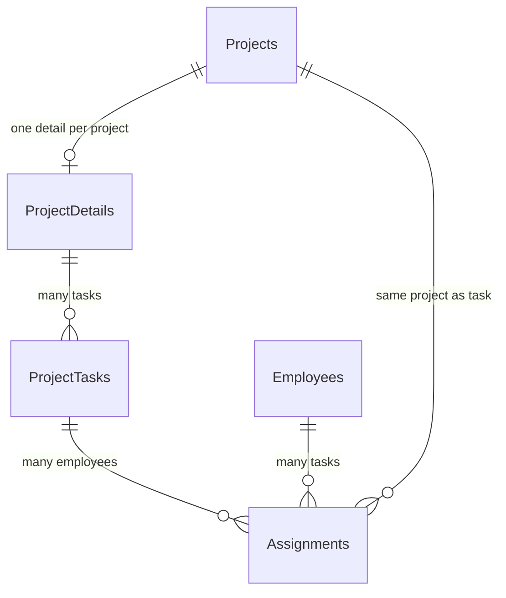

# ProjectManagement — hướng dẫn đọc code

Phần này gồm **Dự án, Chi tiết dự án, Công việc, Phân công**, có xem danh sách, thêm, sửa, xóa và tìm kiếm. Code mới dùng tên tiếng Anh; biến, thuộc tính và phương thức dùng camelCase (`projectId`, `startDate`, `getAll`, `readInput`). Tên lớp giữ PascalCase theo cấu trúc C# của dự án (`ProjectDto`, `ProjectBus`, `ProjectDao`, `ProjectForm`).

## Quan hệ đã thống nhất



- `ProjectDetails.projectId` là khóa ngoại có UNIQUE: mỗi dự án có tối đa một chi tiết. Có thể thêm dự án trước, thêm chi tiết sau.
- `ProjectTasks.projectDetailId` là khóa ngoại: một chi tiết có nhiều công việc.
- `Assignments` lưu `taskId`, `projectId`, `employeeId`; dự án phải đúng với dự án chứa công việc. Mỗi cặp công việc–nhân viên có tối đa một phân công.
- Không lưu `projectDetailId` ngược lại trong `Projects`, và không lưu `taskId` trong `ProjectDetails`, theo điều chỉnh đã được người dùng đồng ý.
- Các mã mới là số nguyên tự tăng (`IDENTITY`); GUI chỉ hiển thị mã, không cho nhập/sửa mã.

Ảnh và file draw.io cũ trong `docs/diagrams` vẫn là bản tham khảo ban đầu, chưa sửa theo các quan hệ đã chốt ở trên. Riêng ProjectManagement, đối chiếu tài liệu này và `database/03_ProjectManagement.sql` khi đọc code.

## Đọc theo thứ tự DTO → DAO → BUS → GUI

| Phần | DTO | DAO | BUS | GUI |
|---|---|---|---|---|
| Dự án | `ProjectDto` | `ProjectDao` | `ProjectBus` | `ProjectForm` |
| Chi tiết | `ProjectDetailDto` | `ProjectDetailDao` | `ProjectDetailBus` | `ProjectDetailForm` |
| Công việc | `ProjectTaskDto` | `ProjectTaskDao` | `ProjectTaskBus` | `ProjectTaskForm` |
| Phân công | `AssignmentDto` | `AssignmentDao` | `AssignmentBus` | `AssignmentForm` |

Các file nằm trong thư mục con tương ứng của `src/DTO/ProjectManagement`, `src/DAO/ProjectManagement`, `src/BUS/ProjectManagement`, `src/GUI/Forms/ProjectManagement`.

Ví dụ khi bấm **Thêm** ở form Dự án:

1. `ProjectForm.readInput()` lấy dữ liệu các ô và tạo `ProjectDto`.
2. `ProjectForm.addButtonClick()` gọi `ProjectBus.add(item)`.
3. BUS gọi `validate(item)` để kiểm tra tên, ngày, ngân sách, phòng ban và quản lý.
4. Khi hợp lệ, BUS gọi `ProjectDao.add(item)`.
5. DAO dùng `MyConnection.CreateConnection()`, mở kết nối và chạy INSERT có tham số. `SCOPE_IDENTITY()` lấy mã vừa tạo trong cùng câu lệnh/kết nối; cách này dùng được với các bảng có trigger.
6. Chỉ sau khi lưu thành công, BUS cập nhật `ArrayList`; GUI thông báo thành công và tải lại danh sách.

`using SqlConnection`, `using SqlCommand` và `using SqlDataReader` tự giải phóng tài nguyên khi thoát hàm, kể cả khi có lỗi. Không ghép trực tiếp dữ liệu người nhập vào câu SQL.

BUS mới gọi DAO trực tiếp bằng constructor thông thường, không thêm interface, lớp cơ sở CRUD hoặc framework mới. `ServiceFactory` tạo các đối tượng để GUI chỉ tham chiếu BUS/DTO. Các hàm truy cập database mới chạy đồng bộ để dễ theo dõi; nếu database chậm, form sẽ chờ trong lúc truy vấn.

`ProjectLookupDao/Bus` đọc phòng ban và nhân viên để chọn trong ComboBox. `LookupItemDto` giữ mã và tên hiển thị. `ProjectFormControls` chỉ hỗ trợ bố cục, điền/chọn ComboBox và hiển thị lỗi; không xử lý SQL hoặc kiểm tra nghiệp vụ.

## Những kiểm tra đang áp dụng

- Tên dự án/công việc bắt buộc, tối đa 150 ký tự; mô tả và ghi chú tối đa 1.000 ký tự. Loại công việc không bắt buộc.
- Hạn hoàn thành không trước ngày bắt đầu. Ngày kết thúc/hoàn thành có thể bỏ trống; nếu nhập thì không trước ngày bắt đầu. Cho phép hoàn thành trễ hạn.
- Ngày phân công không sau ngày bắt đầu công việc của phân công đó.
- Số tiền, giờ dự kiến và điểm đóng góp không âm. Tiến độ/tỷ lệ hoàn thành từ 0 đến 100. Các số thập phân có tối đa 2 chữ số sau dấu thập phân và không vượt kiểu DECIMAL trong SQL.
- Trạng thái: `Not started`, `In progress`, `Completed`, `Cancelled`. Ưu tiên: `Low`, `Normal`, `High`.
- Tiến độ, trạng thái, phụ cấp, thưởng và điểm đóng góp được nhập thủ công. Chưa có công thức tự tổng hợp tiến độ, thang điểm đóng góp hoặc cộng tiền dự án sang bảng lương; các giá trị được kiểm tra độc lập.
- BUS kiểm tra bản ghi liên kết tồn tại; SQL có FOREIGN KEY, UNIQUE và CHECK để kiểm tra lại khi ghi dữ liệu.
- Ba trigger trong script 03 giữ cho dự án của phân công luôn đúng với công việc, kể cả khi chuyển công việc/chi tiết sang dự án khác. Nếu có phân công bị sai quan hệ, thao tác bị hủy toàn bộ; cần xử lý phân công trước.
- Không xóa dây chuyền. Muốn xóa cả dự án, xóa theo thứ tự **Phân công → Công việc → Chi tiết → Dự án**. Form luôn hỏi lại trước khi xóa.

## Tìm kiếm và thao tác form

`search(keyword)` nạp dữ liệu từ DAO vào `ArrayList` của BUS rồi duyệt bằng `foreach`, kiểm tra chuỗi bằng `Contains` không phân biệt hoa/thường. Nhập trống để xem tất cả. Tìm theo mã, các trường văn bản và mã liên kết có trong từng DTO; mã liên kết là số, không tự tìm theo tên nhân viên/phòng ban. Chưa có bộ lọc AND/OR/NOT hoặc so sánh số/ngày nâng cao.

Trên màn hình chính, mở lần lượt **Dự án → Chi tiết dự án → Công việc → Phân công** để tạo dữ liệu cha trước dữ liệu con.

- **Nhập mới**: bỏ chọn dòng cũ, xóa các ô nhập, chuẩn bị thêm.
- **Thêm**: lưu bản ghi mới.
- Chọn dòng trong ListView: dữ liệu được điền vào các ô bên phải. Sau đó bấm **Sửa** hoặc **Xóa**.
- **Tìm kiếm**: áp dụng từ khóa; **Tải lại**: xóa từ khóa và đọc lại dữ liệu cùng các danh mục lựa chọn.
- Ở form Dự án, ListView dưới hiển thị công việc của dự án đang chọn. Việc sửa công việc thực hiện ở form Công việc.
- Ở form Phân công, chọn Dự án trước, rồi chọn Công việc thuộc dự án đó và Nhân viên.
- Ô ngày kết thúc/hoàn thành có checkbox: bỏ tích để lưu NULL. Ngày hiển thị dạng `dd/MM/yyyy`.
- Form Công việc và Phân công có nhiều ô: cuộn vùng bên phải để nhập các ô phía dưới. Danh sách bên trái có thanh cuộn ngang để xem đủ cột.

## Cài database và kiểm tra

Database mới: chạy `01_CreateDatabase.sql`, `02_SeedData.sql`, `03_ProjectManagement.sql`; `04_ProjectManagementSeed.sql` là dữ liệu mẫu tùy chọn. Database đã có schema nền: chỉ cần bổ sung script 03, rồi script 04 nếu muốn dữ liệu mẫu. Script 03/04 có thể chạy lại trên đúng schema này, không xóa bảng cũ. Chúng không tự chuyển đổi một schema ProjectManagement khác đã tồn tại.

Sau khi cấu hình `HRM_CONNECTION_STRING` theo README:

```powershell
dotnet build HumanResourceManagement.sln
dotnet run --project src/GUI
```

Kiểm thử tích hợp, chạy tại thư mục gốc repo:

```powershell
dotnet run --project tests/ProjectManagement.SmokeTests
```

Bộ kiểm thử cần SQL Server cục bộ và Windows Authentication có quyền tạo/xóa database. Mặc định dùng `localhost`; có thể đặt `HRM_TEST_SERVER` nếu dùng instance khác. Nó tạo database `HrmProjectManagementSmoke_<GUID>` riêng, chạy script và CRUD thật, rồi xóa đúng database tạm đó trong `finally`. Không dùng `HRM_CONNECTION_STRING` và không ghi vào database ứng dụng.

Các kiểm tra bao gồm dữ liệu tiếng Việt/dấu nháy, số thập phân, ngày NULL, tìm kiếm, CRUD, dữ liệu sai, tính duy nhất, quan hệ chéo, chặn xóa dữ liệu cha và luồng chọn dữ liệu trên form. Ảnh render form thử nghiệm nằm trong thư mục `bin/.../screenshots` của project kiểm thử.
